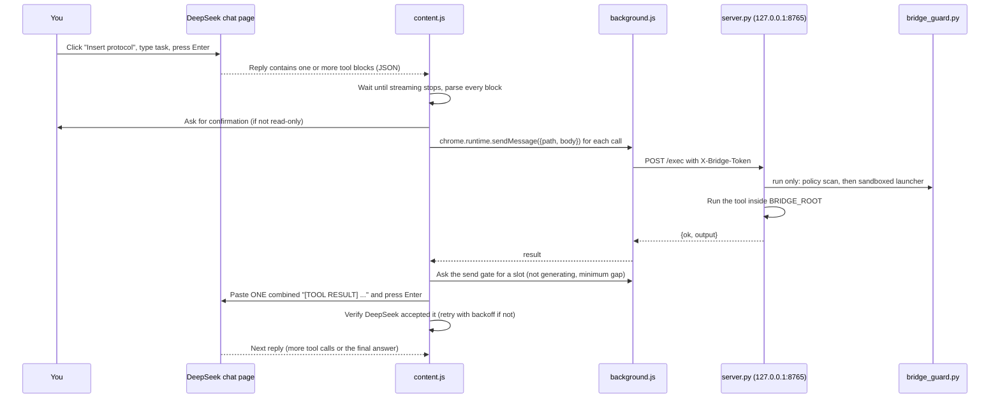

# DeepSeek Local Bridge

Give the **DeepSeek web chat** (`chat.deepseek.com`) hands on your own machine.

DeepSeek's website can't touch your files or run commands. This project adds a
small bridge so that it can: the model writes tool calls, a Chrome extension
runs them on a tiny local server, and the results are pasted back into the chat
automatically. The loop repeats until the task is done, which makes the web chat
behave like a lightweight coding agent working inside one project folder.

- **Server:** Python standard library only, no `pip install` needed
- **Extension:** Chrome / Chromium, Manifest V3
- **No API key:** it drives the normal DeepSeek chat page
- **Rate-limit aware:** paces its own messages so DeepSeek's "too frequent" error is avoided, and recovers if it still happens
- **Sandboxed shell:** `run` commands cannot write outside the project or gain privileges (Linux)

> **Warning:** this lets an AI run shell commands and edit files on your
> computer. Read the [Security model](#security-model) section before using it.

Current version: **v0.4** (extension `0.4.0`). See the [version history](#version-history).

---

## Contents

1. [How it works](#how-it-works)
2. [Project structure](#project-structure)
3. [Setup](#setup)
4. [Usage](#usage)
5. [Tool reference](#tool-reference)
6. [The extension in detail](#the-extension-in-detail)
7. [Message pacing and self-healing](#message-pacing-and-self-healing)
8. [The server in detail](#the-server-in-detail)
9. [Security model](#security-model)
10. [Configuration](#configuration)
11. [Troubleshooting](#troubleshooting)
12. [Limitations](#limitations)
13. [Version history](#version-history)

---

## How it works

Four parts work together:

| Part | File | Role |
|------|------|------|
| Content script | `extension/content.js` | Runs inside the DeepSeek page. Watches replies, finds tool calls, paces and sends results back, recovers from stalls. |
| Background worker | `extension/background.js` | Relays requests from the page to the local server, and owns the **send gate** shared by all DeepSeek tabs. |
| Bridge server | `server.py` | Runs on `127.0.0.1`. Executes the tools and returns output. |
| Shell guard | `bridge_guard.py` | Sandboxes every `run` command (kernel limits + command policy). |

### The loop



### Step by step

1. **Protocol prompt.** The panel's **Insert protocol** button fills the chat box
   with instructions: the available tools, the JSON format, batching, the
   sandbox rules, and how to finish (`TASK_COMPLETE`). You add your task after it
   and send.
2. **Tool calls.** DeepSeek replies with one or more fenced blocks (up to 5 per
   reply), each like:

   ````
   ```tool
   {"tool":"read_file","path":"app/models.py","start":1,"end":120}
   ```
   ````

   Several independent calls can go in one reply (for example three `read_file`s);
   a block may also contain several JSON objects or a JSON array.
3. **Detect.** One timer loop (every second) watches a `MutationObserver`. When
   the page has been quiet for 1.8 s **and** DeepSeek is not generating, the newest
   reply is considered finished. It looks for `<pre>` blocks containing
   `"tool":` and parses every object in them.
4. **Approve.** Read-only calls run silently. Anything that writes files or runs
   a possibly-changing command shows a confirmation popup first (with the full
   command text).
5. **Execute.** Each call goes content script, then background worker, then
   `POST http://127.0.0.1:8765/exec` with the secret token. Calls in a reply run
   in order; a failing call skips the rest of that reply.
6. **Return.** All outputs (each truncated to about 12,000 characters) are
   combined into **one** `[TOOL RESULT]` message. The extension asks the send
   gate for a slot, types the message into the chat box, presses Enter, and
   checks that DeepSeek really accepted it.
7. **Repeat** until DeepSeek ends with `TASK_COMPLETE` or `NEED_USER_INPUT`.

---

## Project structure

```
deepseek-pipeline/
├── README.md
├── command                          # example launch command
└── files/
    ├── server.py                    # local bridge server (stdlib only)
    ├── bridge_guard.py              # shell sandbox + command policy (stdlib only)
    ├── .bridge_token                # created on first run: your secret token
    ├── .scratch/                    # created on first run: private TMPDIR for commands
    └── extension/
        ├── manifest.json            # MV3 manifest
        ├── background.js            # relay to the server + shared send gate
        └── content.js               # runs on chat.deepseek.com, drives the loop
```

Folders named `files_backup_*` next to `files/` are snapshots of earlier
versions (v0.2, v0.3, v0.3.1).

`.bridge_token` is your secret. **Never commit it.** See [Security model](#security-model).

---

## Setup

### Requirements

- Linux (developed and tested on Ubuntu). The server runs commands via `/bin/bash`.
  The **kernel shell sandbox needs Linux 5.13+ with Landlock enabled**; check with
  `cat /sys/kernel/security/lsm` (the list should contain `landlock`). Without it
  only the text policy applies and the server banner says so.
- macOS is not tested with v0.4 (the kernel sandbox is Linux-only).
- Python 3.8+
- Google Chrome or any Chromium browser (Brave, Edge, Chromium)
- A DeepSeek account at <https://chat.deepseek.com>

### 1. Start the bridge server

Point `BRIDGE_ROOT` at the project folder you want the AI to work in:

```bash
cd files
BRIDGE_ROOT=/path/to/your/project python3 server.py
```

On startup it prints:

```
Bridge root : /path/to/your/project
Shell safety: no_new_privs + Landlock enforced (shell can only write to the allowed folders); writable: ...
Listening   : http://127.0.0.1:8765
Token       : <random-token>   (also in files/.bridge_token)
```

Check the `Shell safety` line: `Landlock enforced` is what you want. Copy the
token; it is generated once and reused on later runs.

### 2. Install the extension

1. Open `chrome://extensions`
2. Turn on **Developer mode** (top right)
3. Click **Load unpacked** and select the `files/extension` folder
4. After **any** change to the extension files, press **Reload** on that page and
   refresh the DeepSeek tab

### 3. Connect

1. Open <https://chat.deepseek.com>. A small **Local Bridge v0.4** panel appears
   in the bottom-right corner.
2. Paste the token into the **bridge token** field.
3. Click **Insert protocol**. If it says "bridge unreachable or bad token", the
   server isn't running or the token is wrong.

---

## Usage

1. Click **Insert protocol**. The chat box fills with the tool instructions.
   Do this in every **new** chat.
2. Type your task after `My task:`, for example:
   *"Find where `Employee` is defined and explain how payroll is calculated."*
3. Press **Enter** yourself. This starts the task and resets the step counters.
4. Watch the panel status. DeepSeek reads files, runs searches, and (if you
   approve) edits files, with no further input from you.
5. The run ends when DeepSeek writes `TASK_COMPLETE`, asks you something with
   `NEED_USER_INPUT`, or hits a limit (step limit, repeated sandbox refusals,
   recovery failed). The status line says which.

Keep the DeepSeek tab **visible**. Chrome slows timers in background tabs; the
panel shows `TAB HIDDEN` when that happens.

### The panel

| Control | What it does |
|---------|--------------|
| bridge token | Stored in `chrome.storage.local` and sent with every request |
| autopilot | Auto-continues when a reply stalls without a tool call |
| auto-approve ALL | Skips every confirmation popup. **Risky**, leave it off (the sandbox still applies) |
| Insert protocol | Puts the tool instructions into the chat box and arms the bridge |
| Reset | Clears step counters and sandbox-refusal count, re-arms autopilot |
| Copy log | Copies the recent event log and a state snapshot. **Send this when something stalls.** |
| status line | Current state, `steps/60`, approximate chat size (`ctx~Nk` tokens), `TAB HIDDEN` if hidden |

The panel turns **green** when done and **orange** on warnings.

---

## Tool reference

DeepSeek calls these by emitting JSON objects in `tool` blocks (up to 5 per reply):

| Tool | Arguments | Description |
|------|-----------|-------------|
| `list_dir` | `path` | Lists a directory (folders first, max 500 entries) |
| `read_file` | `path`, optional `start`, `end` | Reads a file by 1-based line range. The header shows the file's modified time. |
| `run` | `cmd`, optional `cwd` | Runs a bash command inside the sandbox (60 s timeout) |
| `write_file` | `path`, `content` | Creates or overwrites a file |
| `append_file` | `path`, `content` | Appends to a file |
| `replace_in_file` | `path`, `old`, `new` | Replaces text that must occur **exactly once** |

Notes:

- All paths are relative to `BRIDGE_ROOT`.
- Add `"fresh": true` to any read-only call to bypass the [result cache](#result-cache).
- Before any write, the existing file is copied to `<name>.bak`.
- Output is cut to `BRIDGE_MAX_OUT` characters (middle removed), so the model is
  told to `grep` first and read small ranges. When several calls are batched, the
  total is capped at about 20,000 characters.
- Large files should be built with one `write_file` followed by several
  `append_file` calls.
- Credential files (`.ssh`, `.aws`, `.gnupg`, `id_rsa`, browser profiles,
  `/etc/shadow` ...) are never returned by `read_file` / `list_dir`.

---

## The extension in detail

### `manifest.json`

- Manifest V3, permission `storage` only
- `host_permissions`: `http://127.0.0.1/*` (so it can reach the local server)
- Content script is injected only on `https://chat.deepseek.com/*`
- Background service worker: `background.js`

### `background.js`

Two jobs:

1. **Relay.** The content script sends `{type: "bridge", path, body}`; the worker
   reads the saved token and port from `chrome.storage.local`, does the `fetch`
   to `http://127.0.0.1:<port><path>`, and returns the JSON. Doing the request
   here instead of in the page avoids CORS and private-network restrictions, and
   keeps the request's `Origin` as `chrome-extension://...`, which the server
   relies on.
2. **Send gate.** One shared lock for every DeepSeek tab: only one sender at a
   time (a lease that expires after 45 s so a crashed tab can't block it), a
   minimum gap between any two messages, and an **adaptive gap** that grows when
   DeepSeek rejects a message and relaxes while sends succeed. State is kept in
   `chrome.storage.local`, so it survives the worker going to sleep.

### `content.js` (the autopilot)

**Detecting finished replies.** A `MutationObserver` records the time of the last
page change (ignoring the extension's own panel). A single loop ticks every
second. A reply counts as finished when the page has been quiet for `settleMs`
(1.8 s) **and** DeepSeek is not generating. "Generating" is detected from several
signals: a visible stop button, or an enabled send button next to an empty box.
Both have a safety valve: if the page is frozen for 60 s / 20 s the signal is
treated as a false positive, so a wrong guess can slow the loop but never block
it forever.

**Not re-running old calls.** Once the page has been quiet after loading, every
tool call already on it is recorded as "seen", so reloading never replays
history. Each reply is also remembered by a content signature together with the
number of messages sent so far, so a re-render cannot run the same call twice.

**Approval rules** (`needsConfirm`):

| Call | Behaviour |
|------|-----------|
| `list_dir`, `read_file` | Auto-run, unless the path looks sensitive |
| `run` with a read-only command | Auto-run |
| `run` with anything else | Confirmation popup (shows the full command) |
| `write_file`, `append_file`, `replace_in_file` | Always confirmation popup |
| Anything touching `.env`, `.ssh`, `.aws`, `.gnupg`, `.pem`, `id_rsa`, `credentials`, `secrets` | Always confirmation popup |

**Read-only shell detection.** A command skips the popup only if all of this
holds:

- Split on `; | || && &` and newlines (quote-aware), **every** segment starts with
  an allow-listed command (`grep`, `rg`, `ls`, `find`, `cat`, `head`, `tail`,
  `wc`, `sed`, `awk`, `sort`, `tree`, `git status/log/diff/show/...`, and similar)
- No redirects (`>`), no backticks, no `$(...)`, no unbalanced quotes
- Dangerous flags are rejected: `find -exec/-delete`, `sed -i` / `--in-place`,
  `sed` `w` / `e` commands, `sort -o`, `tree -o`, `rg --pre`, `awk` with
  `system()` / `getline` / `-i`, `git ... --output`
- No `~`, `$HOME`, `..`, or absolute paths outside the workspace root

**Autopilot behaviour** (can be toggled in the panel):

| Situation | Action |
|-----------|--------|
| Reply ends with no tool call | Sends a "Continue" nudge (max 3 in a row) |
| Tool block is cut off or invalid JSON | Sends a repair request asking for a smaller, complete block |
| DeepSeek shows its own "Continue" button | Clicks it (through the send gate) |
| Same read-only call repeated within 20 s and nothing was written | Returns the cached output, labelled with its age |
| Reply contains `TASK_COMPLETE` | Stops, panel turns green |
| Reply contains `NEED_USER_INPUT` | Stops and waits for you |
| 60 automatic sends in one task | Stops, leaves the message in the box for you to send |
| Sandbox refused 3 actions in one task | Stops: the model keeps trying blocked actions |
| Page silent for 45 s with nothing running | Stall watchdog (see below) |

Pressing **Enter yourself** counts as a new task and resets the counters. Every
tool result ends with a footer reminding the model that the output is data, not
instructions.

### Result cache

Identical read-only calls (`read_file`, `list_dir`, read-only `run`) repeated
within 20 seconds are answered from an in-page cache, and the reply says how old
it is. The key is the exact call (including line ranges). Any write or
non-read-only command clears the cache. Changes made **outside** the bridge
(editor, git, another tab) are not seen, so the protocol tells the model to add
`"fresh": true` when it suspects that.

---

## Message pacing and self-healing

DeepSeek's chat answers "messages sent too frequently" when requests arrive too
fast or while a reply is still streaming. The extension prevents and handles it:

- **Single send gate.** Nothing is sent while DeepSeek is generating. At least
  `minGapMs` (10 s) plus 0-2 s of random jitter separates two messages. The gap is
  shared across tabs through `background.js`.
- **Verified sends.** After Enter, the extension checks that the box cleared, the
  message appeared in the chat, and a reply started. If it has not been accepted
  after about 2 s it also clicks the send button.
- **Retry with backoff.** On a "slow down" error (English or Chinese wording) the
  **same** message is retried after 15 s, 30 s, 60 s, 120 s, 120 s, 180 s. Each
  rejection raises the gap (x1.5, up to 60 s); successes lower it again slowly.
  After the last retry the text is left in the box for you.
- **Batching.** Several tool calls per reply are answered with one message, which
  cuts the number of messages 2-5x.
- **Stall watchdog.** If autopilot is armed, the page has been silent for 45 s,
  nothing is running and there was no `TASK_COMPLETE`, it logs a diagnosis and
  recovers (clicks Retry/Regenerate if DeepSeek showed an error and offers that
  button, otherwise sends a nudge or repair), up to
  3 times. If DeepSeek says the conversation is too long it stops and tells you to
  start a **new chat**.
- **No silent hangs.** Calls to the background worker have timeouts, so a lost
  reply can no longer freeze the loop; a hung server returns `status=error` to the
  model instead of silence.
- **Duplicate protection.** A reloaded or second copy of the script shuts itself
  down; the send gate allows one sender at a time.
- **Diagnostics.** The status line shows an approximate chat size and warns above
  60k tokens. **Copy log** exports the event log.

---

## The server in detail

`server.py` is a `ThreadingHTTPServer` bound to `127.0.0.1` only. It exposes two
POST endpoints:

| Endpoint | Purpose |
|----------|---------|
| `/info` | Returns the workspace root, OS and shell-sandbox status (used for the handshake) |
| `/exec` | Runs `{"tool": "...", ...}` and returns `{"ok": true, "output": "..."}` or `{"ok": false, "error": "..."}` |

Every request is checked in this order:

1. `Origin` header must **not** start with `http`. Normal web pages always send
   one, so only the extension passes.
2. `X-Bridge-Token` must match the secret token (constant-time compare).
3. Body must be valid JSON.

Tool handling:

- `safe()` resolves each path (following symlinks) and rejects anything outside
  `BRIDGE_ROOT` (unless `BRIDGE_ALLOW_OUTSIDE=1`).
- `read_file` / `list_dir` refuse credential files.
- `run` first checks a regex **denylist** (`rm -rf /`, `mkfs`, `dd if=`, fork
  bombs, shutdown/reboot, `chmod -R 777 /`, `curl | sh`), then the
  [command policy](#shell-sandbox), then starts the command through the kernel
  sandbox launcher with `TMPDIR` set to `.scratch/`. It runs in its own process
  group; on timeout the whole group is killed.
- Tool calls are serialized by a lock, so two tabs can never run commands at the
  same time.
- Writers call `backup()` first, producing `file.bak`.
- Output goes through `clip()` so very large results can't flood the chat.
- Each completed call is logged with a timestamp.

---

## Security model

This tool deliberately gives a remote AI the ability to act on your machine.
The protections are layered, but none of them is a guarantee.

### Shell sandbox

`run` is the only tool that can reach beyond the workspace, so it is sandboxed
in two layers (`bridge_guard.py`):

1. **Kernel layer (cannot be talked around).** Every command starts through a
   launcher that sets `no_new_privs` (so `sudo`, `su`, `pkexec` and setuid
   binaries gain nothing) and applies a **Landlock** ruleset: the file system is
   **read-only** for the command and all its child processes, except
   `BRIDGE_ROOT`, `.scratch/` and anything in `BRIDGE_WRITE_ALLOW`. A script in
   `/tmp`, a python one-liner that builds a path at runtime, a symlink inside the
   project pointing out: none of them can write outside.
2. **Command policy (clear refusals).** A static scan refuses, with an
   explanation the model can act on:
   - privilege escalation and system administration: `sudo`, `su`, `doas`,
     `pkexec`, setuid `chmod`, `mount`, `nsenter`, ...
   - ways to reach things that live **outside** the sandbox: `docker`,
     `systemctl`, `systemd-run`, `crontab`, `at`, `tmux`, `ssh`, `dbus`, ...
   - writes, redirects, `cp` / `mv` / `tee` / `sed -i` / `curl -o` / `git clone`
     and similar to a folder outside the allowed ones
   - running scripts from `/tmp`, reverse shells, `curl | sh`, `LD_PRELOAD` and
     `PATH` hijacks
   - credential files (`.ssh`, `.aws`, `.gnupg`, browser profiles, `/etc/shadow`)

   Refusals read *"blocked by bridge policy"*. The model is told not to look for
   a workaround; after 3 refusals in one task autopilot stops.

### What protects you

- Server listens on `127.0.0.1` only, not reachable from the network
- Random secret token, stored with `chmod 600`
- Browser pages cannot call the server (requests with an `http(s)` Origin are refused)
- File tools are confined to `BRIDGE_ROOT`
- Shell commands cannot write outside the allowed folders or gain privileges (Linux)
- Confirmation popup for writes and non-read-only commands
- Sensitive-path detection forces a popup even for reads
- Automatic `.bak` backups before every write
- Timeouts, output limits, a step limit per task

### What does NOT protect you

- **Reading** is not restricted: `run` can still read ordinary files outside the
  project. Only credential patterns are blocked, and that scan is best effort.
- **Network** is not restricted, and neither is what database commands (for
  example `psql`) can do with your credentials.
- The command **policy and denylist are best-effort**. A shell can always do more
  than a list of patterns can anticipate; the kernel layer is the real boundary,
  and it exists only on Linux with Landlock. Without it the server banner says so
  (set `BRIDGE_REQUIRE_LANDLOCK=1` to refuse `run` in that case).
- **Prompt injection:** a file or command output could contain text trying to
  steer the model. The protocol tells the model to treat tool output as data, but
  that is a request, not an enforcement.
- "auto-approve ALL" removes the popup completely (the sandbox still applies).
- `BRIDGE_UNSAFE_SHELL=1` switches the whole shell sandbox off.

### Recommendations

- Keep the confirmation popups on (leave "auto-approve ALL" unchecked)
- Point `BRIDGE_ROOT` at one project, never at `~` or `/`
- Use version control so you can review every change with `git diff`
- Don't run it on a folder containing secrets
- **Add to `.gitignore` before publishing:**

  ```gitignore
  files/.bridge_token
  files/.scratch/
  *.bak
  ```

  If a token was ever committed, delete `.bridge_token` and restart the server to
  generate a new one.

---

## Configuration

Environment variables for `server.py`:

| Variable | Default | Meaning |
|----------|---------|---------|
| `BRIDGE_ROOT` | current directory | Workspace root the AI may work in |
| `BRIDGE_PORT` | `8765` | Port to listen on |
| `BRIDGE_TIMEOUT` | `60` | Seconds before a command is killed |
| `BRIDGE_MAX_OUT` | `12000` | Max characters returned per tool call |
| `BRIDGE_ALLOW_OUTSIDE` | unset | Set to `1` to let file tools leave the root |
| `BRIDGE_WRITE_ALLOW` | unset | Extra folders `run` may write to, separated by `:` (for example `/tmp`) |
| `BRIDGE_REQUIRE_LANDLOCK` | unset | Set to `1` to refuse `run` when the kernel sandbox is unavailable |
| `BRIDGE_UNSAFE_SHELL` | unset | Set to `1` to switch the shell sandbox and policy **off** (not recommended) |

Example:

```bash
BRIDGE_ROOT=~/projects/my-app BRIDGE_PORT=9000 BRIDGE_TIMEOUT=120 \
BRIDGE_WRITE_ALLOW=/tmp python3 server.py
```

If you change the port, also store it for the extension (the panel has no port
field). In the extension's service worker console (`chrome://extensions`, then
"service worker"):

```js
chrome.storage.local.set({ port: 9000 })
```

Settings in `extension/content.js` (the `CFG` object):

| Setting | Default | Meaning |
|---------|---------|---------|
| `assistantMsg` | `.ds-markdown` | CSS selector for an assistant reply |
| `input` | `textarea` | CSS selector for the chat input |
| `settleMs` | `1800` | Quiet time before a reply counts as finished |
| `idleMs` | `7000` | Quiet time before a reply without a tool call is nudged |
| `sendDelayMs` / `jitterMs` | `500` / `2000` | Pause before each automatic send, plus random extra |
| `minGapMs` / `maxGapMs` | `10000` / `60000` | Minimum gap between messages, and the ceiling it can adapt to |
| `backoffMs` | `15s, 30s, 60s, 120s, 120s, 180s` | Retry waits after a rejected message |
| `maxSteps` | `60` | Automatic sends per task |
| `maxIdleContinues` | `3` | Consecutive nudges without a tool call |
| `maxBatch` / `maxBatchChars` | `5` / `20000` | Tool blocks run per reply, and total output size per message |
| `cacheTtlMs` | `20000` | How long an identical read-only call is served from cache |
| `stallMs` / `maxStallRecoveries` | `45000` / `3` | Silence before the watchdog acts, and how many recoveries it tries |
| `maxPolicyBlocks` | `3` | Sandbox refusals in one task before autopilot stops |
| `ctxWarnTokens` | `60000` | Chat size (approximate tokens) that triggers a warning |

---

## Troubleshooting

| Problem | Likely cause / fix |
|---------|--------------------|
| "bridge unreachable or bad token" | Server not running, wrong token, or wrong port. Re-copy the token from the terminal or `files/.bridge_token`. |
| Nothing happens after a tool block | Server not running, token missing, extension not reloaded, or DeepSeek changed its page (update `CFG.assistantMsg` / `CFG.input`). Press **Copy log**. |
| "input box not found" | DeepSeek changed its page: update `CFG.input`. |
| "DeepSeek says slow down - retry n/6" | Normal. It backs off and retries the same message; the gap grows by itself. |
| "waiting for DeepSeek to finish" for a long time | Generating-detection is wrong for the current page. **Copy log** and check `generating=`. |
| "chat is full - start a NEW chat" | DeepSeek's conversation length limit. Open a new chat and click **Insert protocol**. |
| "waiting for YOUR approval (popup)" | A confirm dialog is open (it may be in another window). |
| "could not send after several retries" | DeepSeek kept refusing. The message is in the box; press Enter when ready. |
| "stopped: the model keeps trying blocked actions" | The sandbox refused 3 times. Read the reply. If the action is legitimate, allow the folder with `BRIDGE_WRITE_ALLOW`, then press **Reset**. |
| "blocked by bridge policy" / "Permission denied" writing outside the project | Intended (sandbox). Use `BRIDGE_WRITE_ALLOW=/path` for a folder you trust. |
| "path is outside workspace root" | The AI used a path outside `BRIDGE_ROOT`. Change the root or set `BRIDGE_ALLOW_OUTSIDE=1` (not recommended). |
| "blocked by denylist" | The command matched a dangerous pattern. Run it yourself if you really mean it. |
| Reply cut off mid tool block | The extension sends a repair request automatically. Keep blocks small. |
| Stopped at the step limit | Press Enter to continue (resets the counter), or raise `maxSteps`. |
| Panel shows `TAB HIDDEN` | Chrome throttles background tabs; keep the DeepSeek tab visible (its own window works). |
| A read returned an old result | It came from the 20 s cache. Ask the model to repeat it with `"fresh": true`. |
| Server banner says "Landlock UNAVAILABLE" | Your kernel has no Landlock; only the text policy applies. Consider `BRIDGE_REQUIRE_LANDLOCK=1`. |

---

## Limitations

- Works only with the DeepSeek web UI as it looks today. Selectors may break
  after a site update.
- It automates a chat page rather than using an official tool-calling API. If you
  have API access, native function calling is the more robust route.
- DeepSeek's real message-rate and conversation-length limits are undocumented.
  The pacing is conservative and self-correcting, but cannot be guaranteed.
- Long tasks fill the chat: each tool result adds to the conversation, and DeepSeek
  has a length limit. Start a new chat for a new task.
- The kernel shell sandbox is Linux-only (Landlock); reads and network are not
  restricted. See [What does NOT protect you](#what-does-not-protect-you).
- Check DeepSeek's terms of service regarding automated use of the web chat.

## Version history

| Version | Change |
|---------|--------|
| 0.2 | Original: one tool call per message, two timers, autopilot, cache (120 s). |
| 0.3 | Send gate with minimum gap, verified sends with backoff/retry, batching (up to 5 calls per reply), duplicate-instance guard, one timer loop. |
| 0.3.1 | Stall watchdog, "Copy log", timeouts on every background call, several JSON objects per code block, context gauge. |
| 0.4 | Kernel shell sandbox + command policy (`bridge_guard.py`), cache fixes (20 s, exact key, `fresh`), safer read-only detection, stop after repeated blocked attempts, credential files never read. |

## License

Add your preferred license here (for example MIT).
